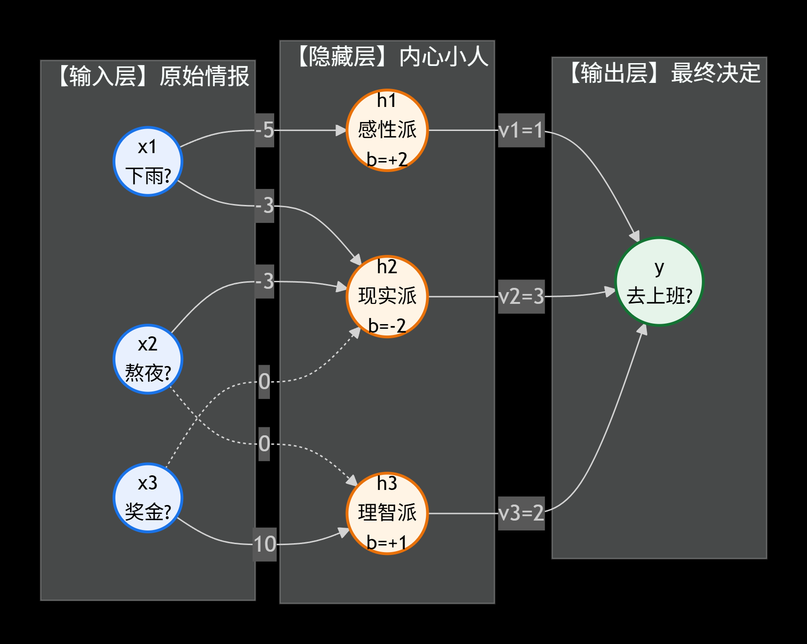
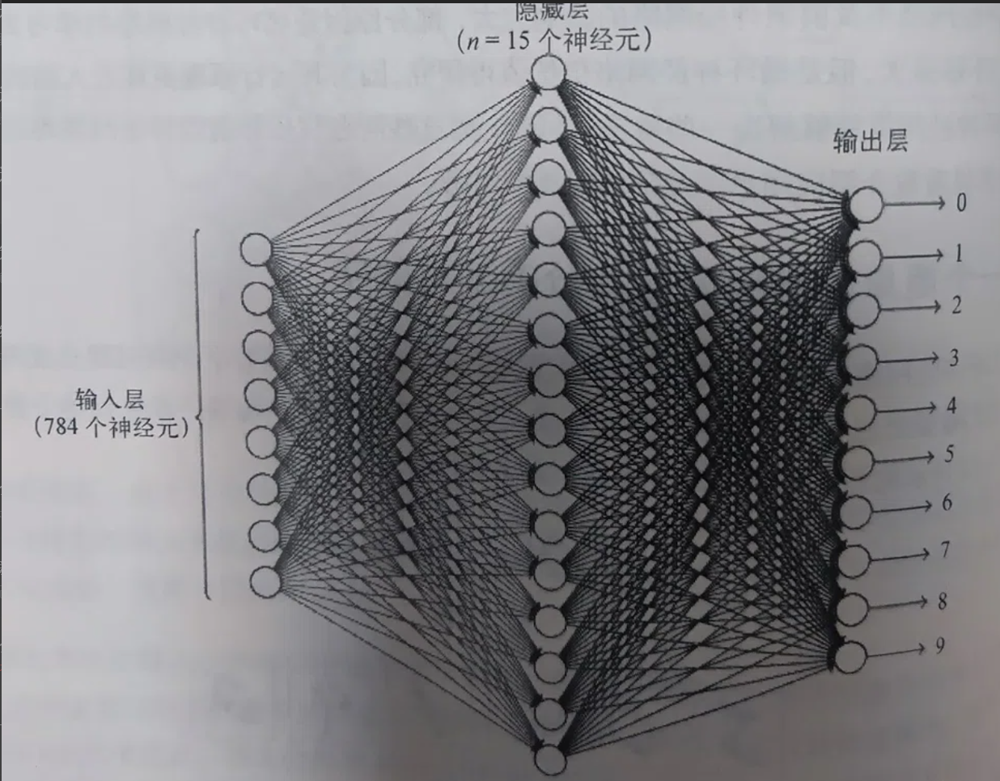

# 全连接神经网络的理解

## 一、是否上班案例



把结构简化为**一层隐藏层**（即：输入层 → 隐藏层 → 输出层），这是最经典、最好理解的神经网络结构。

我们还是用“要不要去上班”来举例。假设你每天早上醒来，大脑都在跑一个神经网络。

为了更直观，我们设计如下：

*   **输入层（3个圈）**：收集客观信息。
*   **隐藏层（3个圈）**：也就是你大脑里的3个“内心小人”，负责综合思考。
*   **输出层（1个圈）**：最终决定（去=1，不去=0）。

---

### 第一层：输入层（情报收集员）

假设你只考虑 3 个因素（3个圈）：

*   $x_1$：**今天下雨了吗？**（下=1，不下=0）
*   $x_2$：**昨晚熬夜了吗？**（熬了=1，没熬=0）
*   $x_3$：**今天有全勤奖吗？**（有=1，没有=0）

这 3 个圈不作任何决策，它们只是把最原始的情报，向外发射出去。

---

### 第二层：隐藏层（3个内心小人）

这一层有 3 个圈（3个神经元）。它们接收了第一层传来的所有情报，但每个人性格不同（即**连线上的权重 $w$ 不同**）。

**1. 小人 A（感性派，代号 h1）**

*   **连线**：从 $x_1$（下雨）连过来的线很粗，权重是 **-5**（极度讨厌下雨）；从 $x_2$（熬夜）连过来的线权重是 **-3**（很累不想动）；从 $x_3$（全勤奖）连过来的线权重是 **0**（感性派不在乎钱）。
*   **偏置（圆圈内的数字 $b$）**：2（天生有点想偷懒）。
*   **计算与激活**：他算了一下总分 $z = -5x_1 - 3x_2 + 0x_3 + 2$。
    *   如果今天下雨且熬夜（$x_1=1, x_2=1$），得分是 -6，远小于0。通过**激活函数**（比如 ReLU，小于0变0），小人 A 直接躺平，向下一层输出 **0**。
    *   如果今天没下雨没熬夜（$x_1=0, x_2=0$），得分是 2。大于0，激活！输出 **2** 分。

**2. 小人 B（现实派，代号 h2）**

*   **连线**：完全不在乎天气，只在乎钱。从 $x_3$（全勤奖）连过来的权重是 **+10**（给钱就是爹）。
*   **偏置**：-2（对上班没什么热情）。
*   **计算与激活**：如果今天有全勤奖（$x_3=1$），算出 8 分，激活输出；如果没有（$x_3=0$），算出 -2 分，低于0，输出0。

**3. 小人 C（理智派，代号 h3）**

*   **连线**：综合考量，下雨权重 -2，熬夜权重 -2，全勤奖权重 +4。
*   **偏置**：1。
*   **计算与激活**：负责把所有的客观因素做一次权衡。

---

### 第三层：输出层（最终决策者）

最右边的那个圈，也就是“最终的你”。

它接收到了隐藏层 3 个小人传来的分数。当然，你对这 3 个小人的意见也有**不同的信任程度（权重）**：

*   你给小人 A（感性）的权重是 **1**。
*   你给小人 B（现实）的权重是 **3**。
*   你给小人 C（理智）的权重是 **2**。
*   你的偏置是 **-3**（你总体上是个比较自律、倾向去上班的人）。

*   **最终计算**：最终得分 = $1 \times (\text{A的分数}) + 3 \times (\text{B的分数}) + 2 \times (\text{C的分数}) - 3$。
*   如果最后算出来的总分大于0，经过激活函数，输出 **1（去上班）**；如果小于0，输出 **0（请假）**。

---

### “为什么这么多连线？”

因为**上一层的每一个圈，都要把信号传给下一层的每一个圈**。

*   输入层有 3 个圈，隐藏层有 3 个圈，它们之间就有 $3 \times 3 = 9$ 根线。每根线代表你对某个因素的重视程度。
*   隐藏层 3 个圈，输出层 1 个圈，它们之间就有 $3 \times 1 = 3$ 根线。

### 为什么要隐藏层？

如果没有隐藏层（直接拿天气、熬夜、奖金来算最终决定），你的大脑就太死板了，这叫“单层感知机”，只能做简单的线性判断。

**有了隐藏层，相当于有了“感性”、“现实”、“理智”这三个中间概念。** 网络不再只是看原始数据，而是先提取出高级的心理活动，再基于这些心理活动做最终决定。这就是神经网络变得“聪明”的原因。

而所谓的**“训练神经网络”**，就是用你过去几百天“去/没去上班”的记录，去**自动调整这些连线上的数字（权重）和圆圈里的数字（偏置）**，直到这个网络算出的结果，完全符合你真实的决策习惯。

---

## 二、手写数字识别案例



假设我们现在有一个已经训练好的神经网络，它的任务就是：**看一张 $28 \times 28$ 的图片，判断它是 0~9 里的哪个数字。**

这个网络的结构就是你书上图 1-20 的样子：**输入层（784个圈） → 隐藏层（15个圈） → 输出层（10个圈）**。

我们以输入一张手写的数字 **“0”** 为例，看看这一路是怎么走过来的：

---

### 第一层：输入层（784个情报员）

*   **对应结构**：784个圆圈。
*   **在这个案例里**：一张图片有 $28 \times 28 = 784$ 个像素点。每个圈就负责接收一个像素点的信息。
    *   如果这个像素是黑色的，圈就收到 1（或者 0~1 之间的灰度值）。
    *   如果这个像素是白色的，圈就收到 0。
*   **它的作用**：这 784 个圈没有任何思想，它们只是把这张图片的原始样子，原封不动地通过密密麻麻的连线，传递给下一层。

---

### 第二层：隐藏层（15个特征检测员）

*   **对应结构**：15个圆圈。
*   **在这个案例里**：这就是书里**图 1-22** 提到的概念。这 15 个圈就像是 15 个“找茬专家”，它们不认完整的数字，只认**局部的碎片形状**。
    *   假设第 1 个圈专门找“左上角的弧线”。
    *   第 2 个圈专门找“右上角的弧线”。
    *   第 3 个圈专门找“中间的一条竖线”。
    *   ...等等。

**它的计算过程是怎样的？**

这 15 个圈，每个圈都会拿到输入层的 784 个像素。但是，每个圈手里有一本“权重账本”（连线上的数字）：

*   当图片传进来时，第 1 个圈（左上角专家）只给图片左上角的像素分配很高的权重（比如 +5），给其他区域的像素分配 0 或者负权重。
*   它算了一下总分：左上角刚好有一道弧线，得分很高。经过**激活函数**，它大喊一声：“我找到了！左上角有弧线！”（输出高分）。
*   同理，第 2、3... 个专家也各自判断，有没有找到自己负责的零件。没找到的，就保持沉默（输出 0）。

---

### 第三层：输出层（10个最终裁判）

*   **对应结构**：10个圆圈（分别代表数字 0、1、2、3、4、5、6、7、8、9）。
*   **在这个案例里**：这 10 个圈是最终的决策者。它们不再直接看 784 个原始像素，而是看着下面 15 个专家的汇报。

**它的计算过程是怎样的？**

这 10 个裁判，每个人都有自己的“偏好权重”：

*   **裁判“0”**：它给“左上角弧线”、“右上角弧线”、“左下角弧线”、“右下角弧线”这四个专家分配了极高的权重。
*   **裁判“1”**：它只给“中间竖线”和“右上角折线”的专家分配高权重。
*   **裁判“8”**：它给左右两边的圈圈专家分配高权重。

**最终发生什么？**

因为输入的确实是数字“0”，那几个负责“四周弧线”的专家疯狂激活（输出高分）。裁判“0”收到了这些高分，一加权算总分，得分极高（比如 9.8 分）。

裁判“1”和“8”因为没收到它们想要的信号，得分很低（比如 0.1 分）。

于是，**裁判“0”被彻底激活**，网络最终输出：**“这张图片是数字 0！”**

---

### 总结：为什么要有“隐藏层”？

如果没有隐藏层，输入层的 784 个像素直接连到输出层，会发生什么？

*   裁判“0”需要死记硬背：第 1 个像素、第 2 个像素、第 35 个像素……必须是黑色，才能是 0。只要手写字稍微歪了一点，裁判“0”就不认识了。

**有了隐藏层（专家）后：**

*   网络学会了**拆分问题**：先找线条、找弧线（隐藏层），再把弧线拼成完整的数字（输出层）。
*   这样，哪怕你写的“0”很胖、很瘦、或者有点歪，只要那四条弧线还在，隐藏层专家就能把它们找出来，输出层依然能认出它是 0。

这就是神经网络通过**“层级特征提取”**来识别手写数字的完整过程。

---

## 三、隐藏层对不同部位检测的理解

要理解“隐藏层神经元负责检测不同部位”，我们需要把宏观的“形状”拆解成微观的“数字”，看看它是怎么通过 $w$（权重）和 $b$（偏置）算出来的。

为了让你看得很透彻，我们**不用 784 个像素那么多**，我们把图片简化成一个 **$3 \times 3$ 的九宫格（9个像素）**。

假设：黑色像素是 1，白色像素是 0。

现在我们要让隐藏层的**第1个神经元（代号：左上角弧线检测员）**来工作。

---

### 1. 直观理解：它凭什么只“检测特定部位”？

因为“全连接”意味着这 9 个像素都会连线到它。但是！**连线的权重（$w$）是它自己调的（或者说训练出来的）。**

这个“左上角检测员”非常有个性（其实是我们通过训练让它的权重变成了这样）：

*   它给**左上角、上中、左中**这三个位置分配的权重是 **正数**（比如 +1，代表“我非常看重你们”）。
*   它给**其余所有位置**（比如右下角、中下）分配的权重是 **0 或负数**（代表“我根本不关心你们”）。

### 2. 对应的计算过程（数学实战）

假设现在输入了一张图片（左上角有一条弧线），像素点如下：

```text
[1, 1, 0]  <- 第一行
[1, 0, 0]  <- 第二行
[0, 0, 0]  <- 第三行
```

这个神经元的具体参数如下：

*   **权重 $w$**：
    *   左上角的线：$w_1 = 1.0$
    *   上边中间的线：$w_2 = 1.0$
    *   左边中间的线：$w_3 = 1.0$
    *   其他所有位置（比如中间、右下角）的线：$w = 0$
*   **偏置 $b$**：**-1.5**。（偏置就像是一个门槛，意味着如果输入的特征不够明显，总分就会低于0，无法激活）。

#### 第一步：线性计算（加权求和 $z = wx + b$）

它把这 9 个像素全部乘上对应的权重加起来：

*   左上角像素(1) $\times 1.0 = 1.0$
*   上中像素(1) $\times 1.0 = 1.0$
*   左中像素(1) $\times 1.0 = 1.0$
*   其他像素(0) $\times 0 = 0$
*   总和：$1.0 + 1.0 + 1.0 = 3.0$

加上偏置 $b = -1.5$：

**最终得分 $z = 3.0 - 1.5 = 1.5$**

#### 第二步：过激活函数（比如 ReLU）

ReLU 函数说：“大于 0 的数原样输出，小于 0 的变成 0”。

因为 $z = 1.5 > 0$，所以这个神经元的**输出 $a = 1.5$**。

**结论：这个神经元“激活”了！它向下一层大喊：“我看到左上角的弧线了！”**

---

### 3. 如果输入的不是“0”呢？

假设现在输入的是数字“1”，图片是这样的：

```text
[0, 0, 0]
[0, 1, 0]  <- 只有中间有像素
[0, 0, 0]
```

- 左上角检测员再次计算：中间那个像素虽然亮着，但因为它给中间分配的权重是 **0**，所以带不来任何分数。
- 得分 $z = 0 - 1.5 = -1.5$。
- 过激活函数，因为 $-1.5 < 0$，直接变成 **0**。
- **结论：这个神经元“沉默”了。它报告：“我没看到左上角的弧线。”**

---

### 💡 核心总结

1.  **为什么叫“检测特定部位”？** 因为**权重决定了它眼睛往哪看**。如果连线上的权重把其他区域全标成了 0，这个神经元实际上就在“管中窥豹”，只盯着局部几个像素。
2.  **计算过程是怎样的？** 就是把你关心的那几个像素乘以一个大权重，加上偏置（门槛）算总分。如果总分大于 0（过激活函数），就代表那个特征被找到了。

**在实际的神经网络中（图1-20）：**

有 15 个隐藏层神经元，它们各自的参数（权重和偏置）一开始是随机的。在学习（训练）的过程中，网络发现：有的神经元把权重调整成了“只看左上角弧线”，有的调整成了“只看右侧竖线”，有的调整成了“只看底部的横线”……最终，这 15 个“瞎子摸象”的检测员，把它们各自看到的局部特征汇总，就能完美拼凑出数字 0 到 9 的完整形状了。

---

## 三、什么是激活函数

**激活函数（Activation Function）就是一个“数字质检员”。它决定了上一个神经元算出来的分数，到底要不要传给下一层，或者要以什么形式传下去。**

---

### 1. 激活函数到底在做什么？

之前看的感知机里，计算过程永远是两步：

1.  **线性计算（搬运工）**：算总分 $z = wx + b$。
2.  **非线性变换（质检员）**：把算出来的 $z$ 塞进激活函数 $f(z)$ 里，得到最终的输出 $a = f(z)$。

这个“质检员”有个规矩：**它接手的输入（$z$）是任意大小的数字，但它输出的结果必须被限制在某个范围里，或者进行某种扭曲。** 只有经过质检员盖章（激活函数处理）的数字，才有资格通过连线，传给下一层的神经元。

### 2. 常见的激活函数长什么样？

*   **阶跃函数（你图1-5用的）**：最严格的门卫。
    *   规则：分数大于等于 0，直接放行输出 1；分数小于 0，直接毙掉输出 0。
    *   特点：就像开关一样，非黑即白。
*   **Sigmoid 函数**：温柔的压缩器。
    *   规则：不管输入多大或多小，它都会把结果死死压缩在 **0 到 1 之间**（适合当概率用）。
    *   比如你算出 100 分，它输出 0.999；算出 -50 分，它输出 0.0001。
*   **ReLU 函数（现代神经网络的最爱）**：最现实的势利眼。
    *   规则：**大于 0 的，原样保留；小于 0 的，统统变成 0**。
    *   也就是我们前面举例的：算出 8 就输出 8，算出 -3 就输出 0。

### 3. 为什么非它不可？

如果没有这个质检员，网络会变成什么样？我们打两个最直观的比方：

**比方一：不给任何门槛的流水线**

如果没有激活函数，就相当于所有机器算出来的分数，不管是正数还是负数，直接就塞给下一层。最后网络只会做纯粹的乘法和加法。在数学上，这就是个一次函数（直线），画在图上就是一条死板的直线，永远没法解决弯弯绕绕的现实问题。

**比方二：没有神经阈值的生物**

在生物学中，神经元要接收到足够强的刺激，才会“放电”传递信号。激活函数就是在模拟这种“放电”机制：

*   如果刺激不够（算出来负数），神经元就沉默（ReLU输出 0）。
*   如果刺激够强（算出来正数），神经元就兴奋，把信号传给下一个人。

### 总结

*   **没有激活函数**：神经网络就是个计算器，只会做 $wx+b$。
*   **有了激活函数**：神经网络就有了“非线性”能力。它能把原本笔直的数据空间**揉捏、折叠、扭曲**，从而能够拟合世间万物复杂的规律（比如识别猫、听懂语音）。

这就是为什么你说“没有激活函数不行”——因为没有它，哪怕你画了 1000 层，这个网络在数学上也就只是一个圆圈的“单层感知机”罢了。

---

## 四、为什么要激活函数

**如果没有激活函数，你画再复杂的神经网络，叠100层、1000层，它本质上就等价于只有一层（一个圈）。**

从数学、几何和实际应用三个层面来看：

### 1. 数学层面：底层逻辑“折叠”了

假设你有一个没有激活函数的网络，有两层：

*   **第一层**：$y_1 = w_1 x + b_1$
*   **第二层**：$y_2 = w_2 y_1 + b_2$

你把第一层的式子代入第二层：

$$
y_2 = w_2 (w_1 x + b_1) + b_2

$$

$$
y_2 = (w_2 w_1)x + (w_2 b_1 + b_2)

$$

你看，无论 $w$ 和 $b$ 是多少，$(w_2 w_1)$ 永远是个常数，$(w_2 b_1 + b_2)$ 也永远是个常数。

所以，它最终依然是一个类似 $y = Wx + B$ 的**直线方程**。

如果你继续加第三层、第四层，最后的结果依然是一条直线。**你辛辛苦苦画了这么多圈和连线，相当于白干了，因为数学上它和一个圈的感知机一模一样。**

### 2. 几何层面：你想画曲线，却只能用直尺

真实世界的问题（比如识别猫、预测股票）极其复杂，数据分布是弯弯曲曲的，根本无法用一条直线完美分开。

*   **没有激活函数**：就好比你手里只有一把**直尺**，无论你叠加多少把直尺，你也只能画出一条直线。
*   **有激活函数**：激活函数（比如 ReLU 把负数变成 0）就像是一个“折叠”操作。它可以把原本平滑的直线掰弯，产生**折角**。有了折角，你就可以用无数短折线拼出极其复杂的曲线，从而拟合真实的复杂世界。

### 3. 实际例子：著名的“异或（XOR）问题”

回到你书里前面的例子：

*   输入 (0, 0) 输出 0
*   输入 (1, 1) 输出 0
*   输入 (1, 0) 输出 1
*   输入 (0, 1) 输出 1

如果你在纸上画一下这四个点，你会发现，**你永远不可能用一条直线把“输出1”和“输出0”的这两拨点分开**。如果只用线性计算（没有激活函数），哪怕你叠了一万层网络，它也是在找一条直线，它永远解不出这个最简单的异或问题。

但是，只要你加一个激活函数（比如你书里图1-5那个把负数变0的阶跃函数），这条直线在数学空间里就被“扭曲”了，一扭，就能完美解决异或问题了。

---

### 总结打个比方：

*   **全连接层（$wx+b$）**：是网络里的“搬运工”，负责把不同的信息加权汇总。但如果只有搬运工，网络就只会把东西直直地搬来搬去，毫无变化。
*   **激活函数**：是网络里的“魔术师”。它会在每一层做一次“非线性扭曲”，把空间揉捏、折叠、变形。正是因为有了这种扭曲，多层神经网络的“深度”才真正有了意义，它才能处理图像、语音、语言这些极其复杂的非线性问题。

---

## 五、梯度下降

### 符号指南（阅读前必看）

*   **$\Delta$（读作 Delta）**：代表**“微小的变化量”**。比如 $\Delta x$ 就是“$x$ 稍微改变了一点点”，$\Delta C$ 就是“误差稍微改变了一点点”。
*   **$\partial$（读作 Partial / 偏导符号）**：代表**“只关注一个变量，其他全当死数字”**时的变化率（偏导数）。
*   **$\nabla$（读作 Nabla）**：代表**“梯度”**。它其实就是把所有的偏导数（$\partial$）打包成的一个**向量（箭头）**。

---

### 第一阶段：微观溯源——为什么 $y=ax$ 的导数是 $a$？（基础微积分）

在进入神经网络之前，我们必须先弄明白微积分中最核心的**导数定义公式**：

**导数 = （$y$ 的变化量 $\Delta y$）除以（$x$ 的变化量 $\Delta x$）**

假设我们有一个最基础的线性函数：$y = a \cdot x$。

我们让 $x$ 稍微增加一个极小的量，记作 $\Delta x$。那么新的 $y$ 就是：

$$
y_{\text{新}} = a \cdot (x + \Delta x)

$$

现在我们来算 $y$ 到底变了多少（即 $\Delta y$）：

$$
\Delta y = y_{\text{新}} - y_{\text{旧}}
= a(x + \Delta x) - ax
= ax + a\Delta x - ax
= a\Delta x

$$

接着，我们把 $y$ 的变化量除以 $x$ 的变化量，求“变化率”：

$$
\frac{\Delta y}{\Delta x} = \frac{a\Delta x}{\Delta x} = a

$$

**结论：** 无论那个微小扰动 $\Delta x$ 是多少，结果永远是系数 $a$。这就是为什么求导时，系数会原封不动地保留下来。

---

### 第二阶段：微观计算——这根线到底有多大“责任”？（偏导数）

带着上面的结论，回到神经网络。在识别手写数字“0”时，网络认错了，误差是 $C$。我们想知道：**“如果我把第 $j$ 根连线 $w_j$ 稍微改一点，误差 $C$ 会跟着变多少？”** 这就是求偏导数 **$\frac{\partial C}{\partial w_j}$**。

> **解释 $\partial$**：为什么不用 $\Delta$ 而用 $\partial$？因为误差 $C$ 受成千上万个参数影响。偏导数 $\partial$ 的意思是：**“现在我假定世界上只有 $w_j$ 这一个变量，其他所有的参数全当常数看”**。

根据**链式法则**，分两步：

#### 第一步：$w_j$ 怎么影响神经元总分 $z$？

加权求和公式：

$$
z = w_1x_1 + w_2x_2 + \dots + w_jx_j + \dots + b

$$

对 $w_j$ 求偏导时，其他 $w$、所有的输入 $x$、偏置 $b$ 全被当成死板的常数。公式就变成了：$z = \text{常数} + x_j \cdot w_j$。

这就回到了我们第一阶段的 $y = a \cdot x$ 形式（这里系数 $a$ 就是 $x_j$）。所以：

$$
\frac{\partial z}{\partial w_j} = x_j

$$

> **物理意义**：权重 $w_j$ 对总分的影响力，完全取决于传进来的信号 $x_j$ 有多大。$x_j=0$ 时毫无影响；$x_j=10$ 时，稍微动一下 $w_j$，总分就会剧变。

#### 第二步：总分 $z$ 怎么影响最终误差 $C$？

这部分经过激活函数和损失函数，记为 $\frac{\partial C}{\partial z}$。

**乘起来（链式法则）：**

$$
\frac{\partial C}{\partial w_j} = \frac{\partial C}{\partial z} \cdot \frac{\partial z}{\partial w_j} = \frac{\partial C}{\partial z} \cdot x_j

$$

---

### 第三阶段：宏观组合——梯度是个什么“鬼”？（$\nabla$ 的登场）

网络里有成千上万个参数。把所有参数对误差的偏导数排成一个列表（向量），这就是**梯度（$\nabla C$）**：

$$
\nabla C = \left( \frac{\partial C}{\partial v_1}, \frac{\partial C}{\partial v_2}, \dots \right)^T

$$

> **解释 $\nabla$**：你可以把它当成一个**打包盒**。上面算出来的都是针对某个具体连线的偏导，用 $\nabla$ 打包后，它就变成了一个指向高维空间的**箭头**。
> **微积分定理**：这个箭头，**永远指向误差 $C$ 增加最快的方向（上坡最陡的方向）**。我们要下山，就必须朝它的反方向走。

---

### 第四阶段：数学证明——凭什么朝反方向走，误差一定变小？

**1. 误差变化近似（全微分）**

假设准备迈出一个微小的步子 $\Delta v$。高度（误差）的变化 $\Delta C$ 近似为两个向量的乘积：

$$
\Delta C \approx \nabla C \cdot \Delta v

$$

**2. 设定下降规则**

为了让 $\Delta C < 0$（下山），设定步子方向与梯度相反（引入步长 $\eta$）：

$$
\Delta v = - \eta \nabla C

$$

**3. 终极代入证明**

$$
\Delta C \approx \nabla C \cdot (-\eta \nabla C)

$$

$$
\Delta C \approx -\eta (\nabla C \cdot \nabla C)

$$

$$
\Delta C \approx -\eta \|\nabla C\|^2

$$

**数学铁证：** $\|\nabla C\|^2$ 必定 $\ge 0$，$\eta$ 是正数，所以 $-\eta \|\nabla C\|^2$ **必定是负数**。只要按这个规则走，误差 $C$ 绝对会下降。

---

### 第五阶段：落地执行——最终公式出炉

新位置 = 老位置 + 步子（$\Delta v$）：

$$
v_{\text{新}} = v_{\text{老}} + \Delta v

$$

代入 $\Delta v$：

$$
v_{\text{新}} = v_{\text{老}} - \eta \nabla C

$$

对应到具体的一根权重连线 $w_j$ 上：

$$
w_j^{\text{新}} = w_j^{\text{老}} - \eta \frac{\partial C}{\partial w_j}

$$

*(代码里就是 `w = w - learning_rate * gradient`)*

---

### 第六阶段：实战循环（手写数字识别全流程）

1.  **前向传播**：输入“0”，网络错认成“8”，误差 $C = 100$。
2.  **反向传播（求导）**：通过第一阶段的微积分定义，系统算出“左上角弧线”传出的信号极强（$x_j=5$），算出了它对应的偏导数 $\frac{\partial C}{\partial w_j} = 10$（这根线闯大祸了）。
3.  **更新参数**：设定学习率 $\eta=0.1$，套用公式：

$$
w_j = w_j - 0.1 \times 10 = w_j - 1

$$

权重被调小。

4.  **循环**：重新前向传播，误差降到 80。再算偏导数、再减梯度……
5.  几万次循环后，所有参数滚落到谷底，网络学会识别数字。

---

### 第七阶段：深度答疑——为什么高度变化是“梯度点乘步子”？

很多人在看到 $\Delta C \approx \nabla C \cdot \Delta v$ 时，都会产生一个巨大的困惑：“高度变化不就是 $C_{\text{终点}} - C_{\text{起点}}$ 吗？凭什么等于**梯度（一个方向）乘上距离（另一个方向）**？”

要想直观理解这个公式，我们需要在脑海里建立一个**“在平地上行走”**的画面。

#### 1. 物理课的类比：做功
想想物理公式：**做功 = 力 × 距离**。如果你斜着拉箱子，真正起作用的只是力在水平方向的分量：**做功 = （力在前进方向的分量） × 移动的距离**。
在数学上，这就叫**点乘（内积）**：$\Delta W = \vec{F} \cdot \Delta \vec{s}$。
在这里，“力”就是梯度，“位移”就是步子，点乘出来的结果就是高度变化。

#### 2. 一维直线下的理解（你的直觉）
设 $C = kv + b$（一条直线，$k$ 是斜率）。取两点 $v_1, v_2$，那么：

$$
\Delta C = C(v_2) - C(v_1) = k(v_2 - v_1) = k \cdot \Delta v

$$

这里的 $k$ 相当于一维的梯度，$\Delta v$ 是步子。在一维里，梯度、割线斜率、导数是一回事。所以你的公式 $\Delta C = \frac{\Delta y}{\Delta x} \cdot \Delta x$ 在直线下是完全成立的。

#### 3. 推广到多维：点积与方向的投影
假设你在二维平面爬山，高度公式是 $C = k_1 v_1 + k_2 v_2 + b$。
*   梯度是 $\nabla C = (k_1, k_2)$（指向最陡的上坡方向）。
*   你走了一步，步子向量是 $\Delta v = (\Delta v_1, \Delta v_2)$。

此时高度变化是多少？

$$
\Delta C = k_1 \Delta v_1 + k_2 \Delta v_2 = (k_1, k_2) \cdot (\Delta v_1, \Delta v_2)

$$

**这就是点积！** 它的几何意义是：

$$
\Delta C \approx \|\nabla C\| \cdot \|\Delta v\| \cdot \cos\theta

$$

（$\theta$ 是梯度方向和步子方向的夹角）。

*   **如果顺着梯度走**（$\theta=0$），$\cos\theta=1$，高度上升最快。
*   **如果逆着梯度走**（$\theta=180^\circ$），$\cos\theta=-1$，高度下降最快（这就是梯度下降）。
*   **如果横着走**（$\theta=90^\circ$），$\cos\theta=0$，高度不变（点积结果为0）。

**所以，点乘的真正含义是：“你实际迈出的这一步，其中有多少是顺着最陡方向走的？”** 顺着最陡方向走的投影长度，乘上坡度（梯度大小），就是你高度的变化量。

#### 4. 为什么非线性时要写“约等于（$\approx$）”？
在直线（线性函数）下，梯度处处相等，上述等式是**精确成立**的。
但当 $C$ 不是直线（比如神经网络复杂的非线性误差曲面）时，梯度是**不断变化**的。你迈出一步之后，脚下的坡度可能就变了。因此，只有当你迈出的步子 $\Delta v$ **足够小**时，$\nabla C \cdot \Delta v$ 才能算作对高度变化的**一阶近似**。这就是公式里写 $\approx$ 的原因。
